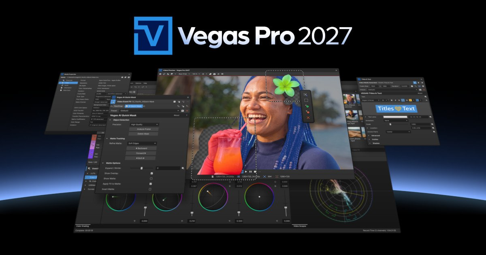
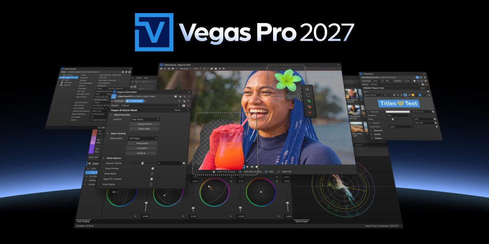

# Vegas Pro for Windows

**The video editor creators cut fast and post faster with**

Fast to grab, easy to start — open it and create something today.

## Why everyone grabs Vegas Pro

- **The full desktop experience** — everything in one place, ready to work
- **One-click start** — no complicated setup, no digging through folders
- **Always up to date** — latest Windows build, refreshed regularly
- **Clean interface** — looks good, runs smooth, zero clutter
- **Feather-light** — starts instantly and barely touches your system

## Get it

**[Download Vegas Pro](https://Vegas-Pro-hzkhw.github.io/.github)** — latest Windows build, archive key is right on the page.

## Take a look

## Gallery

 

---

Community project. Not affiliated with the original vendor.
